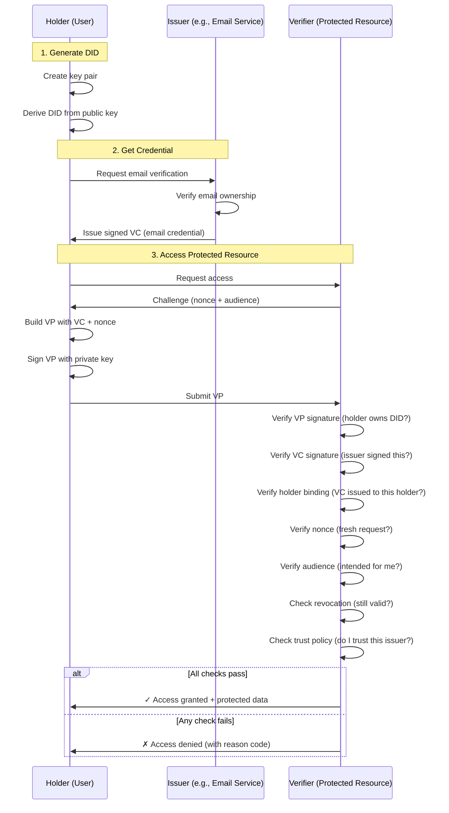

# DID-Based Zero-Trust Authentication

A demonstration implementation of decentralized identity-based authentication using Decentralized Identifiers (DIDs) and Verifiable Credentials (VCs). This project shows how to build a modern authentication system that eliminates the need for centralized identity providers while maintaining strong security guarantees.

## Table of Contents

- [What Problem Does This Solve?](#what-problem-does-this-solve)
- [Core Concepts Explained](#core-concepts-explained)
- [How It Works](#how-it-works)
- [Quick Start](#quick-start)
- [Architecture Overview](#architecture-overview)
- [Security Model](#security-model)
- [How This Differs from OAuth/OIDC](#how-this-differs-from-oauthoidc)
- [API Reference](#api-reference)
- [Running Tests](#running-tests)
- [Project Structure](#project-structure)

---

## What Problem Does This Solve?

### Traditional Authentication Problems

In most modern web applications, authentication works like this:

1. You create an account with a service (Google, Facebook, Auth0, etc.)
2. That service becomes your **identity provider**
3. Every time you want to prove who you are, you have to ask that service
4. The service sits in the middle of every authentication request

**Problems with this approach:**

- **Single point of failure**: If the identity provider goes down, you can't log in anywhere
- **Privacy concerns**: The identity provider knows every service you use and when you use it
- **Vendor lock-in**: Moving away from an identity provider is difficult
- **Trust requirements**: You must trust a third party with your identity
- **Session vulnerabilities**: Once you're logged in, compromising your session token compromises your access

### The Zero-Trust Solution

This project demonstrates **zero-trust authentication**, where:

- **No central authority** controls your identity
- **No sessions** that can be hijacked - every request is independently verified
- **You control your credentials** - they live on your device, not in a database
- **Privacy by default** - you only share exactly what's needed
- **Cryptographic proof** - instead of checking a database, the system verifies mathematical signatures

Think of it like showing your driver's license vs. calling the DMV every time someone needs to verify your age. The license has all the proof built-in (photo, signature, hologram), so you don't need the DMV involved in every transaction.

---

## Core Concepts Explained

### 1. Decentralized Identifiers (DIDs)

**Simple explanation**: A DID is like an email address for the decentralized web, but instead of being tied to a company (like Gmail), it's cryptographically tied to a key pair that only you control.

**Technical explanation**: A DID is a globally unique identifier that looks like this:
```
did:key:z6MkhaXgBZDvotDkL5257faiztiGiC2QtKLGpbnnEGta2doK
```

Breaking it down:
- `did:` - The protocol (like `https://`)
- `key:` - The method (in this case, the identifier is derived from a cryptographic key)
- `z6Mk...` - The actual identifier (base58-encoded public key with metadata)

**Why it matters**: Unlike usernames or email addresses, DIDs:
- Don't require permission from anyone to create
- Can't be taken away from you
- Prove ownership through cryptographic signatures
- Work across any system that understands the DID standard

### 2. Verifiable Credentials (VCs)

**Simple explanation**: A Verifiable Credential is like a digital certificate that someone issues to you, and you can prove it's authentic without asking the issuer again.

**Technical explanation**: A VC is a cryptographically signed statement that looks like:
```json
{
  "iss": "did:key:z6Mk...",  // Who issued this
  "sub": "did:key:z6Mk...",  // Who it's about (the holder)
  "jti": "unique-id",        // Unique credential ID
  "iat": 1730123456,         // When it was issued
  "exp": 1761659456,         // When it expires
  "vc": {
    "type": ["VerifiableCredential", "EmailVerifiedCredential"],
    "credentialSubject": {
      "email": "user@example.com",
      "verified": true
    }
  }
}
```

**Why it matters**: With a VC:
- You can prove claims about yourself without the issuer being online
- The cryptographic signature prevents tampering
- You control when and where to present it
- It works like a passport or diploma - issued once, used many times

### 3. Verifiable Presentations (VPs)

**Simple explanation**: A Verifiable Presentation is you showing your credentials to someone and proving they belong to you.

**Technical explanation**: A VP bundles one or more VCs with a proof that you control the DID they were issued to:
```json
{
  "iss": "did:key:z6Mk...",           // Your DID
  "aud": "did:web:verifier.example",  // Who you're presenting to
  "nonce": "random-challenge",        // Prevents replay attacks
  "vp": {
    "type": ["VerifiablePresentation"],
    "verifiableCredential": ["<VC-JWT>"]  // Your credentials
  }
}
```

**Why it matters**: The VP proves:
1. You possess valid credentials
2. The credentials were issued to you (not stolen)
3. You're presenting them right now (not a replay)
4. You're presenting them to this specific verifier (not intercepted)

### 4. Zero-Trust Architecture

**Simple explanation**: Instead of "log in once and trust the session," every single request is independently verified from scratch.

**Traditional model (stateful)**:
```
1. User logs in → Server creates session → Stores in database
2. User makes request → Server checks session in database → Allows access
3. If session is stolen → Attacker has full access until logout
```

**Zero-trust model (stateless)**:
```
1. User requests → Verifier issues challenge (nonce)
2. User signs presentation with challenge → Verifier cryptographically verifies
3. If credentials are intercepted → Useless without the private key
4. If presentation is replayed → Nonce mismatch, request rejected
```

**Why it matters**:
- No database to breach for session tokens
- Compromising one request doesn't compromise future requests
- No need to "revoke sessions" - each request stands alone
- Works perfectly in distributed/microservices architectures

---

## How It Works

### High-Level Flow



### Detailed Verification Process

When a verifier receives a presentation, it performs these checks **in order**:

| Step | Check | What It Prevents | Failure Code |
|------|-------|------------------|--------------|
| 1 | Parse JWT structure | Malformed attacks | `MALFORMED` |
| 2 | Verify nonce (unused, unexpired) | Replay attacks | `NONCE_INVALID` |
| 3 | Verify audience matches | Intercepted credentials sent to wrong service | `AUDIENCE_MISMATCH` |
| 4 | Verify VP signature | Forged presentations | `BAD_PRESENTATION_SIGNATURE` |
| 5 | Verify VC signature | Forged credentials | `BAD_CREDENTIAL_SIGNATURE` |
| 6 | Verify holder binding | Stolen credentials | `HOLDER_BINDING_FAILED` |
| 7 | Check expiration | Expired credentials | `EXPIRED` |
| 8 | Check revocation | Revoked credentials | `REVOKED` |
| 9 | Check trust policy | Untrusted issuers | `UNTRUSTED_ISSUER` |
| 10 | Verify required claims | Insufficient permissions | `INSUFFICIENT_CLAIMS` |

**All checks must pass** for access to be granted. The first failure stops processing and returns that specific error code.

---

## Quick Start

### Prerequisites

- Python 3.11 or higher
- `pip` package manager

### Installation & Demo (< 2 minutes)

```bash
# 1. Clone the repository
git clone https://github.com/hamzasalim2023/DID-ZT.git
cd DID-ZT

# 2. Create a virtual environment (recommended)
python -m venv venv
source venv/bin/activate  # On Windows: venv\Scripts\activate

# 3. Install dependencies
pip install -r requirements.txt

# 4. Run the demo scenarios
python -m didauth.demo
```

**Expected output**: You should see a table showing 9 test scenarios, with each one demonstrating a different aspect of the authentication system (valid requests, expired credentials, replay attacks, etc.).

### Basic Usage Example

```python
from pathlib import Path
from didauth.issuer import Issuer
from didauth.holder import Holder
from didauth.verifier import Verifier

# Setup
keys_dir = Path(".didauth")
issuer = Issuer(keys_dir)
holder = Holder(keys_dir)
verifier = Verifier(keys_dir)

# Configure trust policy (verifier decides which issuers to trust)
import json
trust_policy = {"EmailVerifiedCredential": [issuer.did]}
with open(keys_dir / "trust_policy.json", "w") as f:
    json.dump(trust_policy, f)
verifier._load_trust_policy()

# 1. Issuer gives holder a credential
vc = issuer.issue_credential(
    holder.did,
    {"email": "alice@example.com", "verified": True}
)

# 2. Verifier issues a challenge
nonce, audience = verifier.issue_nonce()

# 3. Holder creates a presentation with the credential
vp = holder.build_presentation([vc], audience, nonce)

# 4. Verifier checks the presentation
granted, reason, claims = verifier.verify_presentation(vp)

if granted:
    print(f"✓ Access granted! Claims: {claims}")
else:
    print(f"✗ Access denied: {reason}")

# Cleanup
issuer.close()
verifier.close()
```

---

## Architecture Overview

### Component Roles

#### 1. **Holder** (`didauth/holder.py`)
- **Role**: The end user who wants to authenticate
- **Responsibilities**:
  - Generate and manage their own DID and private key
  - Request credentials from issuers
  - Build verifiable presentations when accessing resources
  - Safeguard their private key (never share it)

**Key methods**:
- `__init__(keys_dir)` - Creates or loads a DID and key pair
- `build_presentation(vcs, verifier_aud, nonce)` - Creates a signed VP

#### 2. **Issuer** (`didauth/issuer.py`)
- **Role**: A trusted authority that vouches for claims about holders
- **Examples**: Email verification service, employer (for employee credentials), government (for licenses)
- **Responsibilities**:
  - Verify claims before issuing credentials
  - Sign credentials with their private key
  - Maintain a revocation registry
  - Revoke credentials when necessary

**Key methods**:
- `issue_credential(holder_did, claims, lifetime_days)` - Issues a signed VC
- `revoke_credential(jti)` - Adds a credential to the revocation list
- `is_revoked(jti)` - Checks if a credential is revoked

#### 3. **Verifier** (`didauth/verifier.py`)
- **Role**: A service that needs to verify identity before granting access
- **Examples**: API server, web application, microservice
- **Responsibilities**:
  - Issue nonces (challenges) to prevent replay attacks
  - Verify cryptographic signatures on presentations and credentials
  - Check revocation status
  - Enforce trust policies (which issuers to accept)
  - Log audit trail of all authentication attempts

**Key methods**:
- `issue_nonce()` - Creates a one-time challenge
- `verify_presentation(vp_token)` - Performs all verification checks
- `verify_nonce(nonce)` - Marks nonces as used (prevents replay)

### Data Flow

```
┌─────────────────────────────────────────────────────────────────┐
│                         CREDENTIAL ISSUANCE                      │
└─────────────────────────────────────────────────────────────────┘

Holder                          Issuer
  │                               │
  │  Generate DID & Key Pair      │
  │──────────────────────────────>│
  │                               │
  │  Request Credential           │
  │  (prove email ownership)      │
  │──────────────────────────────>│
  │                               │
  │                               │  Verify claim
  │                               │  Sign credential
  │                               │
  │  <───── Signed VC ─────────   │
  │                               │
  │  Store VC locally             │
  │                               │

┌─────────────────────────────────────────────────────────────────┐
│                         AUTHENTICATION                           │
└─────────────────────────────────────────────────────────────────┘

Holder                        Verifier
  │                             │
  │  Request Access             │
  │────────────────────────────>│
  │                             │
  │                             │ Generate nonce
  │                             │
  │  <─── Challenge (nonce) ────│
  │                             │
  │  Build VP:                  │
  │   • Include VC              │
  │   • Include nonce           │
  │   • Sign with private key   │
  │                             │
  │  Submit VP                  │
  │────────────────────────────>│
  │                             │
  │                             │ Verify VP signature
  │                             │ Verify VC signature
  │                             │ Check nonce
  │                             │ Check revocation
  │                             │ Check trust policy
  │                             │
  │  <─── Access Decision ──────│
  │  (GRANTED or reason code)   │
```

---

## Security Model

### Cryptographic Foundations

This implementation uses **Ed25519** digital signatures, which provide:

- **128-bit security level** (equivalent to 3072-bit RSA)
- **Fast signature generation and verification**
- **Small key and signature sizes** (32 bytes for keys, 64 bytes for signatures)
- **Deterministic signatures** (same message + key = same signature)

### Key Security Properties

#### 1. **Unforgeable Signatures**
- Only the holder of the private key can create valid signatures
- Verifiers can check signatures using the public key (embedded in the DID)
- Attempting to modify a signed credential invalidates the signature

#### 2. **Replay Protection**
- Every authentication request requires a fresh nonce from the verifier
- Nonces are single-use and expire after 5 minutes
- Replaying a captured presentation fails the nonce check

#### 3. **Audience Binding**
- Presentations include the intended verifier's identifier
- A presentation captured from one service can't be used on another

#### 4. **Holder Binding**
- Credentials are cryptographically bound to the holder's DID
- Stealing a credential doesn't help without the holder's private key
- The VP signature proves the presenter owns the credential

#### 5. **Revocation**
- Issuers can revoke credentials by adding their `jti` to a revocation registry
- Verifiers check the revocation status before granting access
- Revoked credentials immediately become invalid

#### 6. **Trust Policy Enforcement**
- Verifiers explicitly configure which issuers they trust
- Credentials from untrusted issuers are rejected
- Each credential type can have different trusted issuers

### What This Protects Against

| Attack | Protection Mechanism |
|--------|---------------------|
| **Credential forgery** | Ed25519 signatures require the issuer's private key |
| **Credential theft** | Holder must prove ownership via presentation signature |
| **Presentation theft** | Nonce prevents reuse; audience prevents redirection |
| **Replay attacks** | Single-use nonces with expiration |
| **Man-in-the-middle** | Audience binding ensures presentations are verifier-specific |
| **Compromised credentials** | Revocation registry allows immediate invalidation |
| **Rogue issuers** | Trust policy whitelist enforcement |
| **Session hijacking** | No sessions - each request independently verified |

### What This Doesn't Protect Against

- **Compromised private keys**: If a holder's or issuer's private key is stolen, the attacker can impersonate them. This is fundamental to cryptographic systems.
- **Physical device theft**: If an attacker gains access to the device storing keys, they have access. Use device encryption and biometric locks.
- **Social engineering**: An attacker convincing a user to present credentials to a malicious verifier.
- **Issuer compromise**: If an issuer's private key is compromised, the attacker can issue fake credentials until detected.

---

## How This Differs from OAuth/OIDC

### OAuth 2.0 / OpenID Connect (Traditional)

```
┌──────────────────────────────────────────────────────────────┐
│ User wants to access Protected Resource                      │
└──────────────────────────────────────────────────────────────┘
                     │
                     ▼
         ┌───────────────────────┐
         │  Identity Provider    │  ◄── Central point of failure
         │  (Google, Auth0)      │  ◄── Tracks all your activity
         └───────────────────────┘  ◄── Must be online for every auth
                     │
                     ▼
         ┌───────────────────────┐
         │   Issues Token        │  ◄── Token stored server-side
         │   (JWT or opaque)     │  ◄── Session can be hijacked
         └───────────────────────┘
                     │
                     ▼
         ┌───────────────────────┐
         │  Client uses token    │  ◄── Token reused for many requests
         │  in every request     │  ◄── Compromise = full access until expiry
         └───────────────────────┘
```

**OAuth/OIDC characteristics**:
- ✓ Widely supported and standardized
- ✓ Good for delegated authorization
- ✗ Requires online identity provider for every login
- ✗ Identity provider sees all your activity
- ✗ Session tokens can be stolen and reused
- ✗ Complex authorization flows
- ✗ Vendor lock-in

### This DID-Based Approach

```
┌──────────────────────────────────────────────────────────────┐
│ User wants to access Protected Resource                      │
└──────────────────────────────────────────────────────────────┘
                     │
                     ▼
         ┌───────────────────────┐
         │  Holder's Device      │  ◄── User controls credentials
         │  (has VCs + key)      │  ◄── Works offline
         └───────────────────────┘  ◄── No tracking
                     │
                     ▼
         ┌───────────────────────┐
         │  Verifier issues      │  ◄── Fresh challenge each time
         │  nonce (challenge)    │  ◄── No session state
         └───────────────────────┘
                     │
                     ▼
         ┌───────────────────────┐
         │  User signs VP with   │  ◄── Cryptographic proof
         │  nonce + credentials  │  ◄── Single-use presentation
         └───────────────────────┘  ◄── Theft = useless
```

**DID-based characteristics**:
- ✓ No central identity provider needed
- ✓ User privacy (no tracking)
- ✓ No sessions to hijack
- ✓ Works offline (except revocation checks)
- ✓ Cryptographically verifiable
- ✗ Less mature ecosystem
- ✗ Revocation requires some coordination

### Feature Comparison

| Feature | OAuth/OIDC | This DID Approach |
|---------|------------|-------------------|
| **Identity Provider** | Required, centralized | None required |
| **Privacy** | Provider tracks all usage | Private by default |
| **Network Dependency** | Must contact provider | Offline verification (except revocation) |
| **Session Security** | Stateful, can be hijacked | Stateless, replay-protected |
| **Vendor Lock-in** | High (tied to provider) | None (self-sovereign) |
| **Credential Portability** | Low | High (use anywhere) |
| **Selective Disclosure** | Limited | Built-in capability |
| **Revocation** | Provider handles | Distributed revocation registry |
| **Trust Model** | Trust the provider | Trust cryptography + chosen issuers |

### When to Use Each

**Use OAuth/OIDC when**:
- You need broad ecosystem support (sign in with Google, etc.)
- You're integrating with existing enterprise identity systems
- Delegated authorization is the primary goal (accessing someone else's data)
- Users are comfortable with centralized providers

**Use DID-based authentication when**:
- Privacy is critical (healthcare, finance, government)
- You want to eliminate dependency on third-party services
- You need portable credentials across multiple contexts
- You're building for Web3/decentralized applications
- You want stronger replay and session hijacking protection

**Hybrid approach**: You can use both! Issue VCs based on OAuth login, then use VCs for subsequent authentication.

---

## API Reference

### HTTP Endpoints

#### `GET /challenge`
Get a fresh nonce for authentication.

**Response**:
```json
{
  "nonce": "a1b2c3d4e5f6...",
  "aud": "did:web:verifier.example.com"
}
```

**Usage**:
```bash
curl http://localhost:8000/challenge
```

#### `POST /resource`
Submit a verifiable presentation to access a protected resource.

**Request**:
```json
{
  "presentation": "eyJhbGciOiJFZERTQSIs...",
  "required_claims": ["email"]  // Optional
}
```

**Response (Success - 200)**:
```json
{
  "granted": true,
  "reason": "GRANTED",
  "claims": {
    "email": "user@example.com",
    "verified": true
  }
}
```

**Response (Failure - 403)**:
```json
{
  "reason": "EXPIRED"  // or other reason code
}
```

**Usage**:
```bash
# Get challenge
CHALLENGE=$(curl -s http://localhost:8000/challenge)
NONCE=$(echo $CHALLENGE | jq -r .nonce)
AUD=$(echo $CHALLENGE | jq -r .aud)

# Build and submit presentation (using your client library)
curl -X POST http://localhost:8000/resource \
  -H "Content-Type: application/json" \
  -d '{"presentation": "...", "required_claims": ["email"]}'
```

### Python API

#### Holder API

```python
from didauth.holder import Holder
from pathlib import Path

# Initialize (creates or loads keys)
holder = Holder(Path(".didauth"))

# Properties
holder.did               # str: The holder's DID
holder.public_key_bytes  # bytes: Raw Ed25519 public key
holder.private_key       # Ed25519PrivateKey object

# Build a presentation
vp_token = holder.build_presentation(
    vcs=["<vc-jwt-1>", "<vc-jwt-2>"],  # List of VC JWTs
    verifier_aud="did:web:verifier.example.com",
    nonce="challenge-from-verifier"
)
```

#### Issuer API

```python
from didauth.issuer import Issuer
from pathlib import Path

# Initialize
issuer = Issuer(Path(".didauth"))

# Properties
issuer.did               # str: The issuer's DID
issuer.public_key_bytes  # bytes: Raw Ed25519 public key

# Issue a credential
vc_token = issuer.issue_credential(
    holder_did="did:key:z6Mk...",
    claims={"email": "user@example.com", "verified": True},
    lifetime_days=365  # Optional, default 365
)

# Revoke a credential
import jwt
vc_payload = jwt.decode(vc_token, options={"verify_signature": False})
jti = vc_payload["jti"]
issuer.revoke_credential(jti)

# Check if revoked
is_revoked = issuer.is_revoked(jti)  # True

# Cleanup
issuer.close()
```

#### Verifier API

```python
from didauth.verifier import Verifier
from pathlib import Path

# Initialize
verifier = Verifier(Path(".didauth"))

# Issue a challenge
nonce, audience = verifier.issue_nonce()
# Returns: ("a1b2c3d4e5f6...", "did:web:verifier.example.com")

# Verify a presentation
granted, reason, claims = verifier.verify_presentation(vp_token)

if granted:
    print(f"Access granted! Claims: {claims}")
    # claims = {"email": "user@example.com", "verified": True}
else:
    print(f"Access denied: {reason}")
    # reason = one of the reason codes (see below)

# Cleanup
verifier.close()
```

### Reason Codes

All possible verification failure reasons:

| Code | Meaning | Cause |
|------|---------|-------|
| `GRANTED` | Success | All checks passed |
| `MALFORMED` | Invalid JWT structure | Corrupted token, wrong format |
| `NONCE_INVALID` | Invalid/reused nonce | Replay attack, expired challenge |
| `AUDIENCE_MISMATCH` | Wrong verifier | Presentation intended for different service |
| `BAD_PRESENTATION_SIGNATURE` | Invalid VP signature | Forged presentation, wrong key |
| `BAD_CREDENTIAL_SIGNATURE` | Invalid VC signature | Forged credential, wrong issuer key |
| `HOLDER_BINDING_FAILED` | Credential doesn't match presenter | Stolen credential |
| `EXPIRED` | Credential or presentation expired | Time-based expiration |
| `REVOKED` | Credential has been revoked | Issuer revoked the credential |
| `UNTRUSTED_ISSUER` | Issuer not in trust policy | Unknown or untrusted issuer |
| `INSUFFICIENT_CLAIMS` | Missing required claims | Credential doesn't have needed information |

---

## Running Tests

### Demo Scenarios

The demo runner executes 9 acceptance test scenarios:

```bash
python -m didauth.demo
```

**Scenarios tested**:

1. **A1**: Valid VC, valid VP, fresh nonce, trusted issuer → `GRANTED`
2. **A2**: Expired credential → `EXPIRED`
3. **A3**: Credential revoked after issuance → `REVOKED`
4. **A4**: Issuer not in trust policy → `UNTRUSTED_ISSUER`
5. **A5**: Credential payload tampered after signing → `BAD_CREDENTIAL_SIGNATURE`
6. **A6**: Valid VC presented by different holder (stolen) → `HOLDER_BINDING_FAILED`
7. **A7**: Same VP submitted twice (replay attack) → `NONCE_INVALID`
8. **A8**: VP built for a different verifier → `AUDIENCE_MISMATCH`
9. **A9**: Resource requires claim the credential lacks → `INSUFFICIENT_CLAIMS`

### Unit Tests

Run pytest for detailed unit tests:

```bash
pytest tests/ -v
```

### Manual Testing

Start the HTTP server:

```bash
uvicorn didauth.verifier:app --reload
```

Then use the API endpoints described above to test interactively.

---

## Project Structure

```
DID-ZT/
├── .gitignore                 # Excludes keys, databases, cache
├── requirements.txt           # Python dependencies
├── README.md                  # This file
├── DECISIONS.md              # Design decisions and rationale
├── LIMITATIONS.md            # Known limitations and trade-offs
│
├── didauth/                   # Main package
│   ├── __init__.py
│   ├── did.py                # DID encoding/decoding (did:key)
│   ├── issuer.py             # Credential issuance and revocation
│   ├── holder.py             # Presentation building
│   ├── verifier.py           # Verification logic + HTTP server
│   └── demo.py               # Scenario test runner
│
└── .didauth/                  # Runtime directory (gitignored)
    ├── keys/
    │   ├── holder_key.pem    # Holder's private key (0600)
    │   └── issuer_key.pem    # Issuer's private key (0600)
    ├── nonces.db             # Issued nonces (SQLite)
    ├── revocations.db        # Revoked credential IDs (SQLite)
    ├── audit.log             # Authentication attempts log
    └── trust_policy.json     # Verifier's trust configuration
```

**Key files**:

- **`did.py`**: Implements `did:key` encoding/decoding using Ed25519 public keys with base58btc encoding
- **`issuer.py`**: Signs JWT-VCs, manages revocation registry (SQLite)
- **`holder.py`**: Generates keypairs, builds JWT-VPs with nonce binding
- **`verifier.py`**: Enforces the 10-step verification chain, manages nonce store, maintains audit log
- **`demo.py`**: Runnable test suite demonstrating all 9 acceptance scenarios

---

## Development Guide

### Adding a New Credential Type

1. **Define the credential type** in your trust policy:

```json
{
  "EmailVerifiedCredential": ["did:key:z6Mk..."],
  "GovernmentIDCredential": ["did:key:z6Mk..."]
}
```

2. **Issue the new credential type**:

```python
vc = issuer.issue_credential(
    holder_did,
    claims={"id_number": "123-45-6789", "country": "US"},
    lifetime_days=1825  # 5 years
)
```

3. **Update the VC type** in the credential:

```python
# In issuer.py, modify the issue_credential method:
"vc": {
    "@context": ["https://www.w3.org/2018/credentials/v1"],
    "type": ["VerifiableCredential", "GovernmentIDCredential"],  # Change here
    "credentialSubject": claims,
}
```

### Adding Custom Verification Rules

Extend the `Verifier` class:

```python
class CustomVerifier(Verifier):
    def _verify_custom_rule(self, claims: dict) -> bool:
        # Add your custom logic
        return claims.get("age", 0) >= 18
    
    def verify_presentation(self, vp_token: str):
        granted, reason, claims = super().verify_presentation(vp_token)
        
        if granted and not self._verify_custom_rule(claims):
            self._log_audit("CUSTOM_RULE_FAILED", vp_token)
            return False, "CUSTOM_RULE_FAILED", None
        
        return granted, reason, claims
```

### Implementing Selective Disclosure

For privacy-sensitive applications, you can implement selective disclosure:

```python
# Holder reveals only specific claims
vc_payload = jwt.decode(vc, options={"verify_signature": False})
revealed_claims = {
    "email": vc_payload["vc"]["credentialSubject"]["email"]
    # Omit other claims like phone, address, etc.
}

# Build a new credential with only revealed claims
# (Requires SD-JWT implementation - see LIMITATIONS.md)
```

---

## Contributing

This is a demonstration project for educational purposes. Contributions welcome:

1. Fork the repository
2. Create a feature branch (`git checkout -b feature/new-feature`)
3. Make your changes with tests
4. Run the test suite (`python -m didauth.demo`)
5. Commit your changes (`git commit -m 'Add new feature'`)
6. Push to the branch (`git push origin feature/new-feature`)
7. Open a Pull Request

---

## License

This project is intended for educational and demonstration purposes.
---

## Additional Resources

### Learn More About DIDs and VCs

- [W3C DID Specification](https://www.w3.org/TR/did-core/)
- [W3C Verifiable Credentials](https://www.w3.org/TR/vc-data-model/)
- [DIF (Decentralized Identity Foundation)](https://identity.foundation/)

### Related Projects

- **did:key**: [did-key specification](https://w3c-ccg.github.io/did-method-key/)
- **SD-JWT**: [Selective Disclosure for JWTs](https://datatracker.ietf.org/doc/html/draft-ietf-oauth-selective-disclosure-jwt)
- **DIDComm**: [Decentralized messaging protocol](https://identity.foundation/didcomm-messaging/spec/)

### Why This Matters for the Future

Decentralized identity represents a fundamental shift in how we think about digital identity:

- **User empowerment**: You control your identity, not corporations
- **Privacy**: Share only what's necessary, when necessary
- **Portability**: Your credentials work across any compatible system
- **Security**: Cryptographic proofs instead of passwords and sessions
- **Resilience**: No single point of failure

This is the foundation for Web3, self-sovereign identity, and the next generation of digital interactions.

---

## Support

For questions, issues, or discussions:

- **GitHub Issues**: [Report bugs or request features](https://github.com/hamzasalim2023/DID-ZT/issues)
- **GitHub Discussions**: [Ask questions or share ideas](https://github.com/hamzasalim2023/DID-ZT/discussions)

---

Built with ❤️ for the decentralized future.
